---
prev:
  text: STEMSpark4Kids App
  link: https://STEMSpark4Kids.vercel.app/
next:
  text: Whiteboard App
  link: https://STEMSpark4Kids-whiteboard.vercel.app/
---

# STEMSpark4Kids User Guide

This page documents the user-facing functionality currently implemented in STEMSpark4Kids. Screens that require authentication redirect visitors to `/login`. Role-restricted screens redirect users without the required role back to `/dashboard`.

Go to App link: https://STEMSpark4Kids.vercel.app

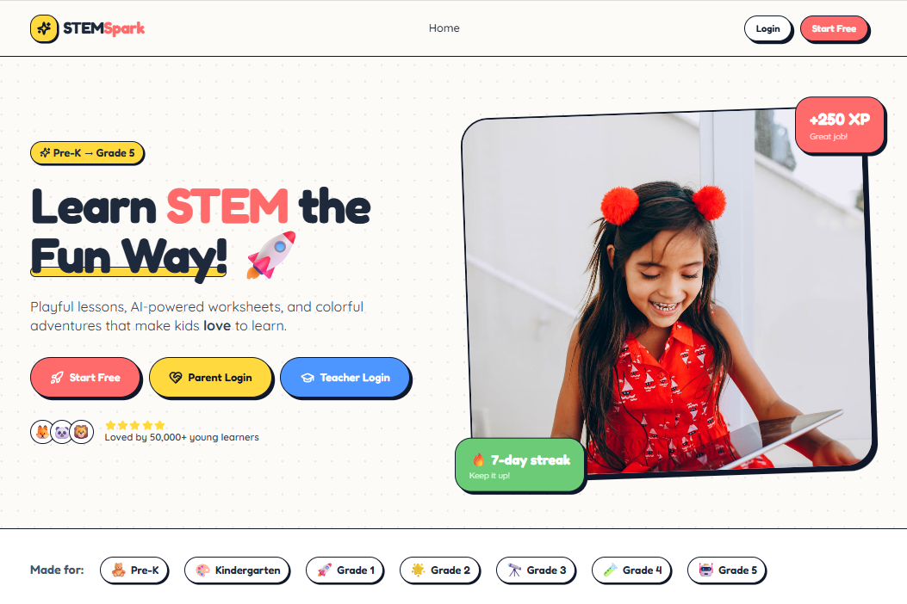

## Navigation and access

The shared application layout provides the main navigation and footer. The `/dashboard` route is a role router: after authentication it sends users to the dashboard for their role.

| Route | Page | Access |
| --- | --- | --- |
| `/` | Landing | Public |
| `/login` | Login | Public |
| `/register` | Registration | Public |
| `/onboarding` | Role selection | Signed-in users |
| `/dashboard` | Dashboard redirect | Signed-in users |
| `/student` | Student dashboard | Students |
| `/parent` | Parent dashboard | Parents |
| `/teacher` | Teacher dashboard | Teachers |
| `/subject/:subjectId` | Subject activities | Signed-in users |
| `/activity/:subjectId/:activityId` | Activity player | Signed-in users |
| `/ai-worksheet` | AI worksheet generator | All signed-in roles |
| `/leaderboard` | Weekly leaderboard | Signed-in users |
| `/progress` | Progress reports | Signed-in users |
<!-- | `/admin` | Admin console | Admins | -->

## Public pages

### Landing page: `/`

The landing page introduces STEMSpark4Kids and gives visitors three entry points:

- **Start Free** opens registration.
- **Parent Login** opens login with the parent role suggested.
- **Teacher Login** opens login with the teacher role suggested.

Visitors can also select a subject card to open that subject after signing in. The page displays supported grades from Pre-K through Grade 5, the subject catalog, product features, and testimonials.

### Registration: `/register`

1. Choose a role: student, parent, or teacher.
2. If registering as a student, choose a grade from Pre-K through Grade 5.
3. Enter a name, email, and password of at least six characters.
4. Submit the form or use Google sign-up when Google authentication is configured.

Successful registration sends the user to `/dashboard`. Registration errors appear as toast notifications.

### Login: `/login`

Users can sign in with email and password or Google. A successful login sends the user to `/dashboard`, which chooses the correct role dashboard. The page accepts an optional role query parameter, for example `/login?role=parent`, to show the suggested role in the form.

Google login requires `REACT_APP_GOOGLE_CLIENT_ID` in `frontend/.env`. Without it, the page shows a configuration message instead of the Google button.
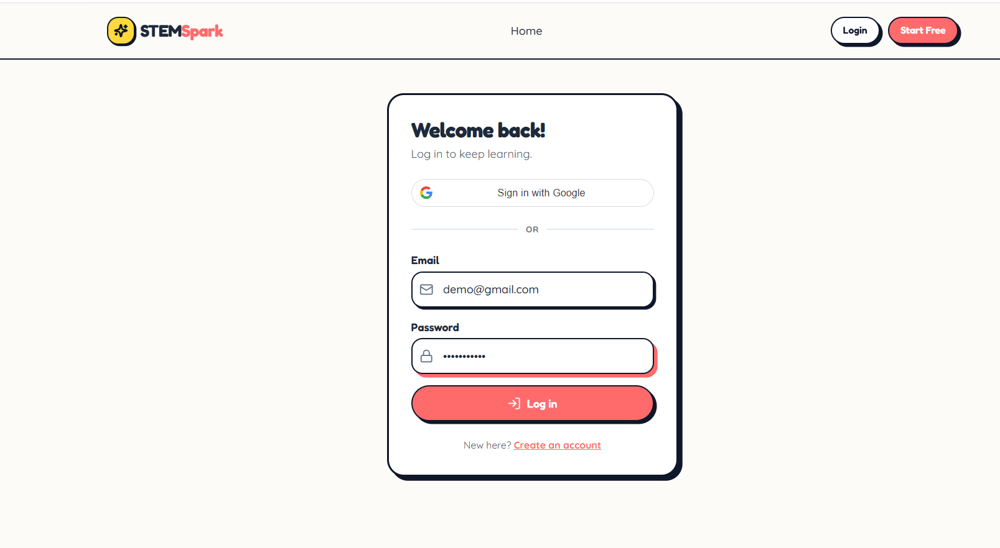

### Authentication callback

When an external authentication flow returns with a `session_id` hash, STEMSpark4Kids exchanges it with the backend, stores the returned session token, updates the user, removes the hash from the URL, and redirects to the dashboard. Failed exchanges return the user to login.

## Onboarding and dashboards

### Role selection: `/onboarding`

Signed-in users can choose student, parent, or teacher. Students can also select a grade. **Continue** saves the profile through the backend and returns to the role dashboard.

### Student dashboard: `/student`

The student dashboard is the main learning home:

- Shows the learner greeting, grade, XP, coins, and day streak.
- Shows earned and locked badges.
- Provides a four-step daily path with an estimated 30-minute duration. Selecting a step opens its activity.
- Lists all available subjects. Selecting a subject opens its activity catalog.
- Shows recent completed activities with score, stars, and XP when progress exists.
- Links to the full progress report through **See all progress**.
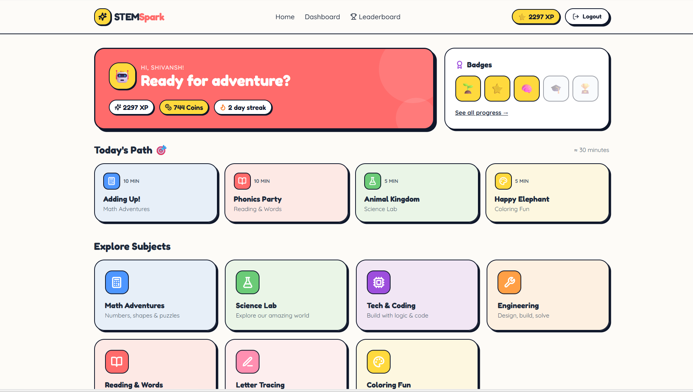

### Parent dashboard: `/parent`

Parents can:

1. Enter a child’s registered email and choose **Link Child**.
2. Review linked children, grade, XP, and streak.
3. Choose **View Progress** to load the child’s ten most recent completions, including date, subject, activity, and score.
4. Close the child detail panel.
5. Open the AI Worksheet Generator.

The child must have an existing student account before linking.
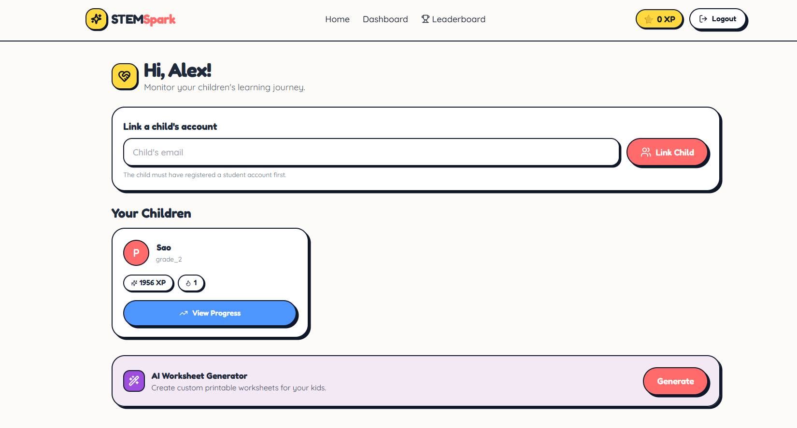

### Teacher dashboard: `/teacher`

Teachers manage classrooms and assignments:

1. Choose **New Classroom**.
2. Enter a classroom name, grade, and optional description.
3. Open a classroom to view students and assignments.
4. Copy the classroom join code to share with students.
5. Create an assignment with a title, subject, activity, optional due date, and optional target student.
6. Review assignments shown for the class and for individual students.

Teachers can also open the AI Worksheet Generator from the dashboard.

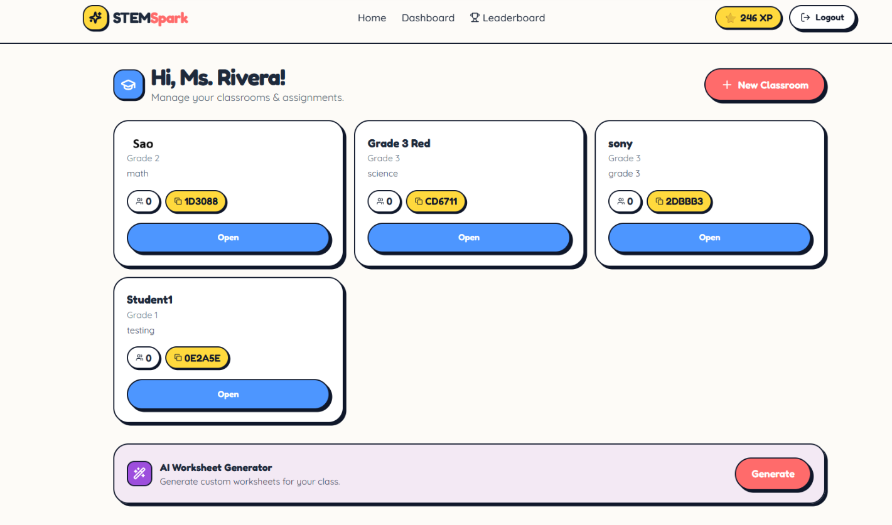

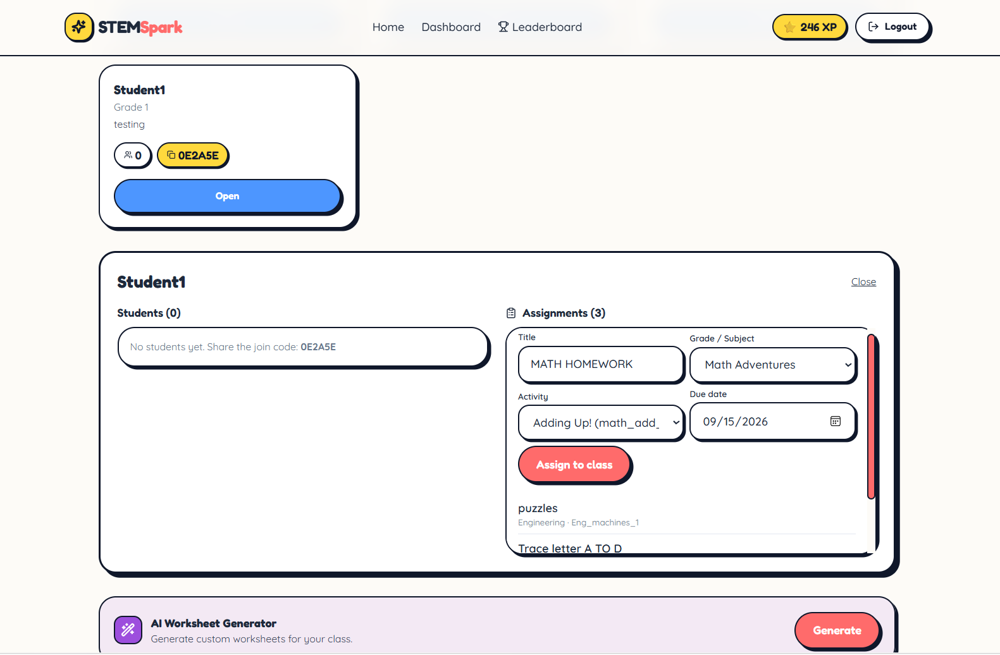

<!-- ### Admin console: `/admin`

Admins receive a platform overview with total users, users by role, completions, users, generated worksheets, and classrooms. The **Recent Users** table shows each user’s name, email, role, subscription plan, XP, and creation date. -->

## Learning catalog

### Subject view: `/subject/:subjectId`

Subject pages show the subject tagline, topic badges, and available activity cards. Each activity card displays its type, difficulty, title, and topic. Choose **Start** to open the activity player. Use **Back** to return to the previous page.

The current subjects are:

| Subject | Topics | Activity types currently available |
| --- | --- | --- |
| Math Adventures | Counting, addition, subtraction, shapes, patterns, multiplication, fractions | Quiz, flashcards |
| Science Lab | Plants, animals, human body, weather, space, water cycle | Quiz, flashcards |
| Tech & Coding | Computer basics, typing, AI basics, Scratch, digital safety | Quiz |
| Engineering | Simple machines, bridges, physics, design thinking, problem solving | Flashcards |
| Reading & Words | Phonics, sight words, comprehension, vocabulary, spelling | Quiz, flashcards |
| Letter Tracing | Uppercase/lowercase letters, numbers, shapes, words | Tracing |
| Coloring Fun | Animals, dinosaurs, space, alphabet, robots | Coloring |

Subjects without activities show a **Coming soon** state.

### Quiz activities

1. Read the question and choose one answer.
2. The selected answer is immediately marked correct or incorrect.
3. Choose **Next** to continue, or **Finish** on the final question.
4. On completion, the app records the score and time, refreshes the user profile, and shows XP, coins, and stars.
5. Choose **Try Again** to restart or **Back** to return to the subject.

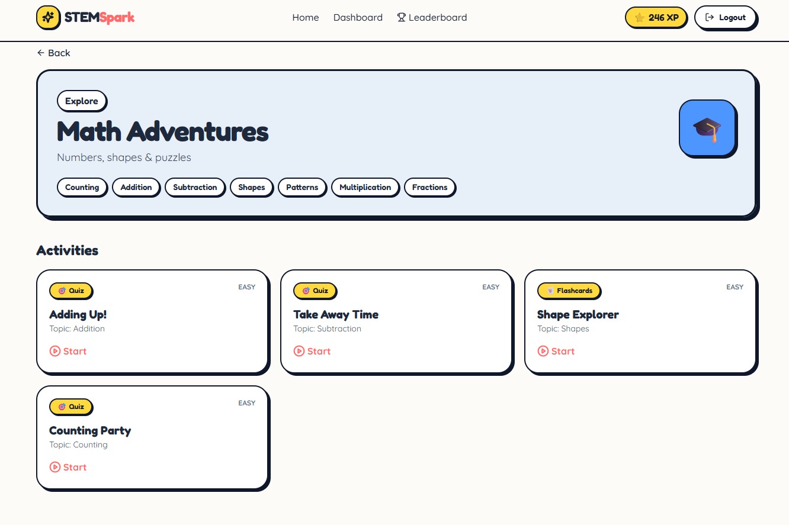

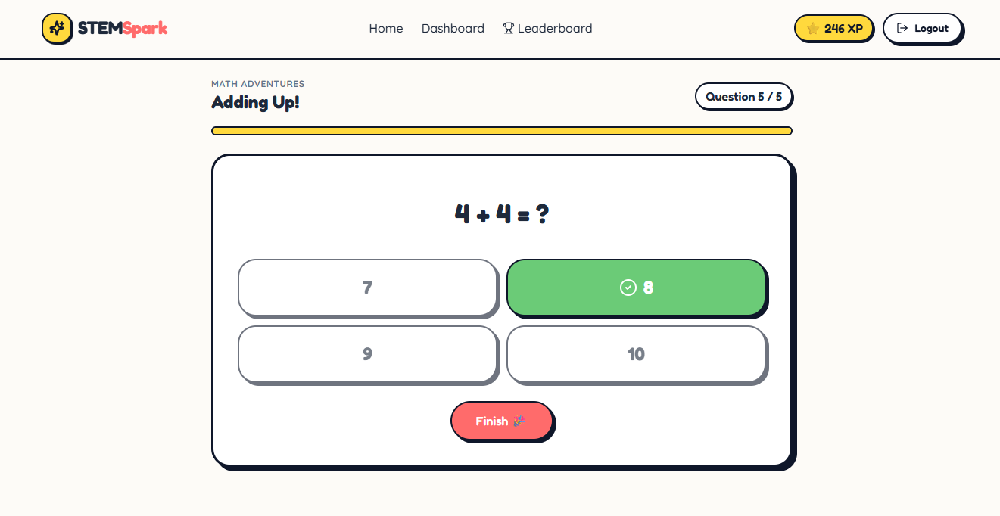

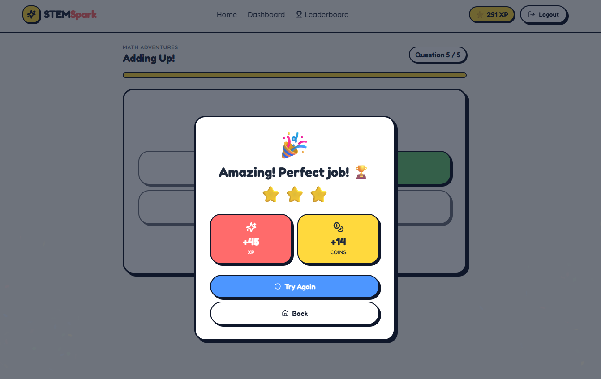

### Flashcard activities

- Select the card to reveal its answer.
- Use **Prev** and **Next** to move through cards.
- Choose **I know this** to mark the current card as known and advance.
- Choose **Finish** on the final card to record completion.
- The result modal offers **Try Again** and **Back**.
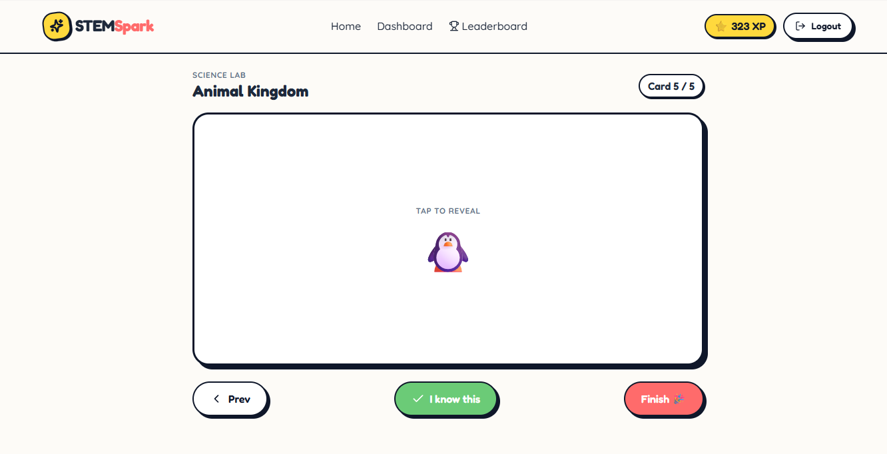

### Coloring activities

Coloring activities provide a canvas with an optional template. Users can:

- Select a color from the palette.
- Select one of four brush sizes.
- Draw with mouse or touch input.
- Use **Undo**, **Clear**, and **Save** to download a PNG.
- Choose **Done** to record completion based on drawing effort.

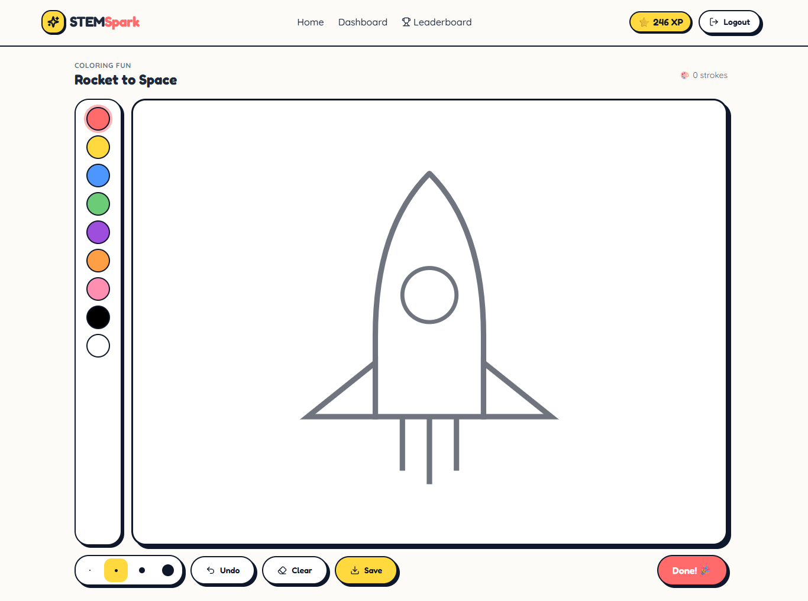

### Tracing activities

Tracing activities show a ghost character or letter over a canvas:

- Choose **Hear it** to read the current character aloud when browser speech synthesis is available.
- Trace using mouse or touch input.
- Choose **Try again** to clear the current canvas.
- Choose **Next Letter** to continue, or **Finish** on the last character.

Tracing completion records the activity and opens the standard result modal.

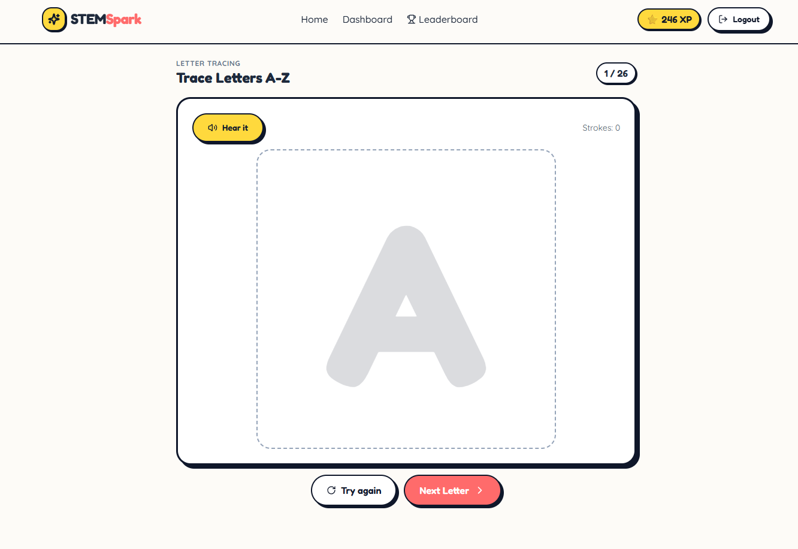

### Completion results

Completed activities display a result modal with a message, one to three stars, XP earned, and coins earned. Two actions are available: restart the activity or return to the subject/student area. Results with at least two stars also trigger celebratory confetti.

## Progress and motivation

### Progress report: `/progress`

The progress page displays:

- XP earned, coins, day streak, and total activities.
- A weekly activity bar chart.
- A by-subject completion chart.
- A recent activity table with date, subject, activity, score, and stars.

Empty accounts show guidance to start learning instead of charts or rows.

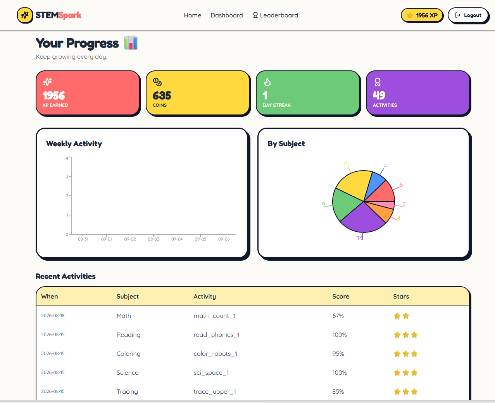

### Leaderboard: `/leaderboard`

The leaderboard loads weekly learners from the backend and shows rank, avatar or initial, name, grade, and XP. The signed-in user’s row is highlighted and labeled **you**. Empty results show a first-learner message.

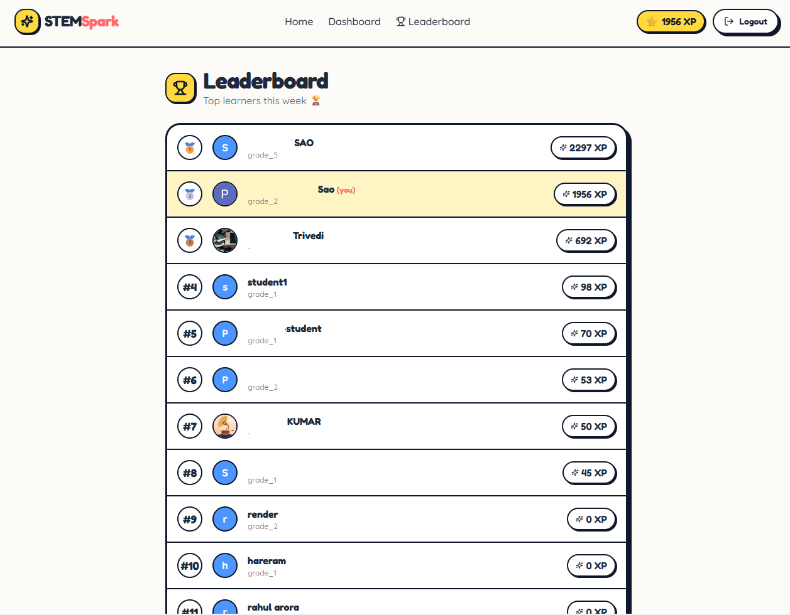

## AI Worksheet Generator: `/ai-worksheet`

The worksheet generator is available to every authenticated role:

1. Choose a subject.
2. Enter a topic.
3. Choose a grade.
4. Choose easy, medium, or hard difficulty.
5. Set the number of questions from 3 to 15.
6. Choose **Generate**.

The generated worksheet includes instructions, name/date fields, questions, and hints. **Show Answers** toggles answer visibility. **Print / PDF** opens the browser print flow, where the worksheet can be printed or saved as a PDF. Recent worksheets appear in the history list and can be reopened.

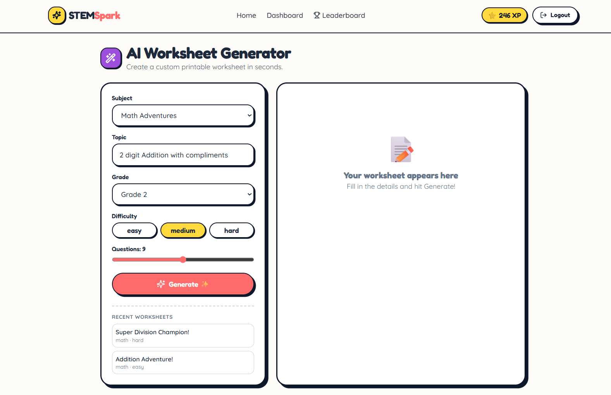

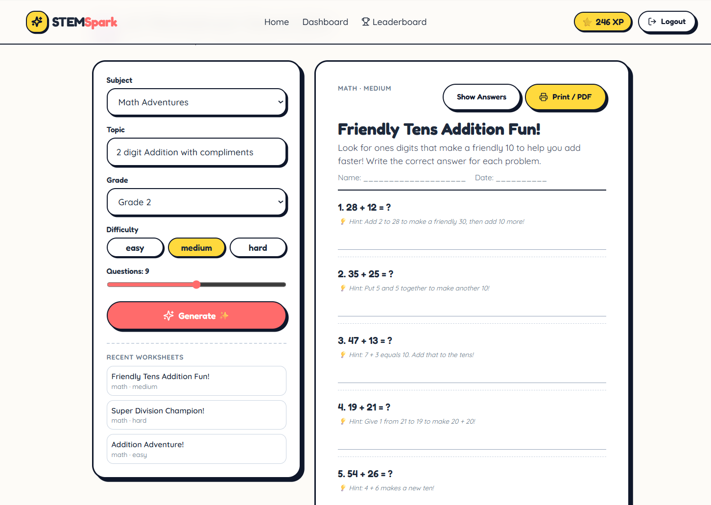

<!-- ## Payments

The pricing component and pricing links are currently commented out in the application, so there is no active pricing route in the current UI.

Payment callback screens are implemented:

- `/payment/success?session_id=...` polls the backend until payment is paid, failed, or times out. A paid session refreshes the user and offers **Go to Dashboard**.
- `/payment/cancel` confirms that checkout was cancelled and no charge was made.

## Empty, loading, and error states

Most data-backed pages show a loading or empty state while waiting for the API. API failures are generally surfaced as toast messages or leave the relevant collection empty. Invalid subject or activity IDs show a not-found message instead of opening the player. -->